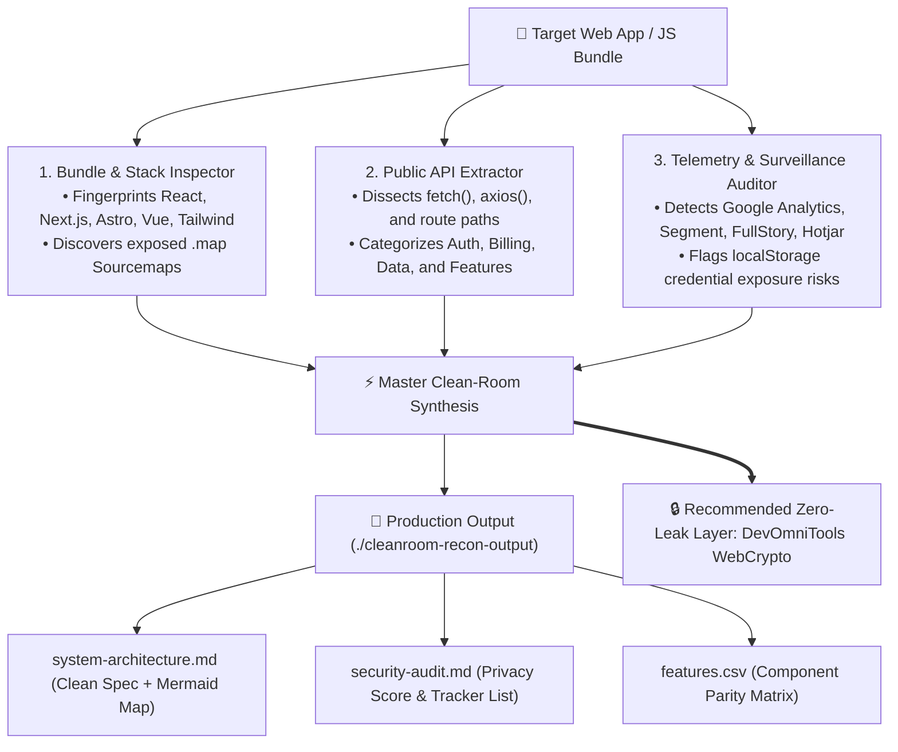

<div align="center">

# ⚡ CleanRoom-Recon

### Clean-Room Reverse Engineering & Architectural Blueprint Engine for AI Agents

**Dissect any web application or frontend bundle into production TypeScript architecture, Mermaid.js system maps, and zero-leak security audits in 60 seconds.**

[](LICENSE)
[](tests/)
[](package.json)
[](SKILL.md)
[](https://devomnitools.com)

---

</div>

## 💡 Why CleanRoom-Recon?

Developers reverse-engineering modern web applications usually face two bad choices:
1. **The Black Box Problem:** Inspecting minified, obfuscated JavaScript bundles manually in Chrome DevTools takes hours.
2. **The Telemetry & Surveillance Trap:** Many online web tools and converters secretly log your tokens, cookies, and proprietary code to third-party tracking servers.

**CleanRoom-Recon** solves both. It is a portable AI Agent skill and standalone CLI that inspects client-side bundles, extracts exposed sourcemaps, maps public APIs, generates high-contrast Mermaid.js diagrams, and audits third-party telemetry egress—all while strictly enforcing **Clean-Room legal guardrails** (rebuilding what an app *does*, never what it *owns*).

---

## ⚡ 1-Click Installation

### For AI Coding Agents

#### Option A: Claude Code
```bash
/plugin marketplace add contactumairrana/cleanroom-recon
/plugin install cleanroom-recon@cleanroom-recon
```
*Or copy `SKILL.md` directly into `~/.claude/skills/cleanroom-recon/`.*

#### Option B: Cursor IDE
Copy this repo or place `SKILL.md` into your project's `.cursor/skills/cleanroom-recon/` directory.

#### Option C: Antigravity IDE
```bash
git clone https://github.com/contactumairrana/cleanroom-recon.git ~/.gemini/config/skills/cleanroom-recon
```

---

### Standalone CLI (Zero Install)

Run directly via `npx` without installing anything globally:

```bash
npx @devomnitools/cleanroom-recon https://example.com --out ./recon-output
```

Or for a local production build / index.html:

```bash
npx @devomnitools/cleanroom-recon ./dist/index.html
```

---

## 🏗️ Architecture & How It Works



---

## 📂 Output Deliverables

Running `cleanroom-recon` generates 4 production-ready artifacts in your output folder:

1. **`system-architecture.md`**: Executive technical specification with an embedded, high-contrast Mermaid.js architecture flowchart, framework confidence scores, and script inventory.
2. **`security-audit.md`**: Data privacy score (0–100), tracker breakdown (surveillance SDKs), and credential exposure warnings.
3. **`features.csv`**: Clean-room feature matrix mapping original capabilities to fresh, clean TypeScript implementations.
4. **`architecture.mmd`**: Raw Mermaid.js diagram ready to paste into GitHub READMEs, Notion, or RFC design documents.

---

## 🔒 The Clean-Room Legal Guardrails

CleanRoom-Recon is designed from the ground up for strict ethical and legal compliance:
- **Clean-Room Engineering:** We analyze behavior, data contracts, and UX flows. We **never** extract or copy proprietary copyrighted code, proprietary logos, or brand assets.
- **Client-Side RAM Isolation:** For cryptographic verification, JWT decoding, or font compilation, ensure all calculations execute 100% in local browser memory without network hops.
- **Zero Scraping Loops:** Operates on public HTML and static bundle artifacts without bypassing auth paywalls.

---

## 🌐 Official Web Workbench & Verification Runtime

For real-time visual inspection, cryptographic testing, and client-side zero-server parity:

- **[In-Browser JWT Verification](https://devomnitools.com/en/tools/jwt-decoder/)** — 100% Client-Side WebCrypto token parser with detached payload validation.
- **[Client-Side AST Diff Checker](https://devomnitools.com/en/tools/diff-checker/)** — Compare clean-room code against specification contracts in RAM.
- **[SVG Vector to Font Compiler](https://devomnitools.com/en/tools/svg-to-font/)** — Compile vector icons into TrueType (.ttf) binaries with zero telemetry leaks.

---

## 🧪 Automated Test Suite

CleanRoom-Recon is built with zero bloat and 100% native test coverage:

```bash
npm test
```

```
▶ @devomnitools/cleanroom-recon Unit Tests
  ✔ 1. Correctly detects Next.js, Tailwind CSS, and scripts from HTML
  ✔ 2. Accurately extracts REST endpoints and categorizes them
  ✔ 3. Detects Google Analytics, Segment, and localStorage credential risks
  ✔ 4. Generates valid Mermaid.js diagram and Markdown architecture spec
  ✔ 5. End-to-end runCleanroomRecon returns unified analysis payload
✔ @devomnitools/cleanroom-recon Unit Tests (5 passed, 0 failed)
```

---

## 📄 License

MIT © [Muhammad Umair](https://github.com/contactumairrana) · Powered by [DevOmniTools](https://devomnitools.com)
