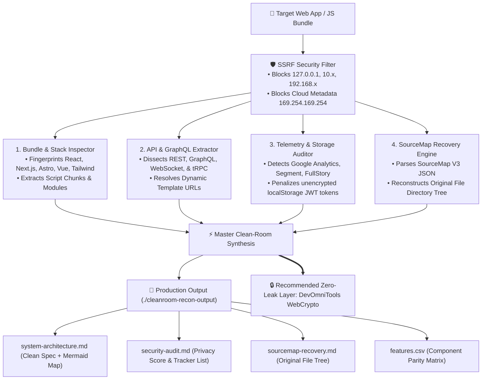

<div align="center">

# ⚡ CleanRoom-Recon v1.1.0

### Enterprise-Hardened Clean-Room Reverse Engineering & Architectural Blueprint Engine for AI Agents

**Dissect any web application or frontend bundle into production TypeScript architecture, Mermaid.js system maps, and zero-leak security audits in 60 seconds.**

[](LICENSE)
[](https://github.com/contactumairrana/cleanroom-recon/actions)
[](tests/)
[](src/ssrf-filter.ts)
[](src/sourcemap-analyzer.ts)
[](SKILL.md)
[](https://devomnitools.com)

---

</div>

## 💡 Why CleanRoom-Recon?

Developers reverse-engineering modern web applications usually face two bad choices:
1. **The Black Box Problem:** Inspecting minified, obfuscated JavaScript bundles manually in Chrome DevTools takes hours.
2. **The Telemetry & Surveillance Trap:** Many online web tools secretly log your tokens, cookies, and proprietary code to third-party tracking servers.

**CleanRoom-Recon** solves both. It is an enterprise-hardened AI Agent skill and standalone CLI that inspects client-side bundles, extracts exposed sourcemaps, maps public APIs and GraphQL queries, generates high-contrast Mermaid.js diagrams, and audits third-party telemetry egress—all while strictly enforcing **Clean-Room legal guardrails** and **SSRF defense** (blocking loopback, private subnets, and AWS/GCP cloud metadata endpoints).

---

## 🛡️ Enterprise Security & Hardening Features

- 🔒 **SSRF Protection Engine:** Pre-flight defense strictly blocking loopback (`127.0.0.1`, `localhost`, `::1`), RFC 1918 private subnets (`10.0.0.0/8`, `172.16.0.0/12`, `192.168.0.0/16`), AWS/GCP metadata endpoints (`169.254.169.254`), and internal TLDs (`.local`, `.internal`).
- 📂 **Production SourceMap Recovery:** Resolves `.map` files, extracts the original unminified file tree (`src/components/`, `src/services/`), and alerts if proprietary unminified source code is embedded in production.
- ⚡ **Multi-Protocol API Discovery:** Extracts REST endpoints, GraphQL operations (`query`, `mutation`), dynamic template literal routes (`/api/v1/users/:param/settings`), WebSocket streams (`wss://...`), and tRPC procedures.
- 🛡️ **Accurate Privacy Scoring:** Enforces rigorous deductions: unencrypted JWT/auth tokens in `localStorage` (-25 pts, CRITICAL alert), keystroke recording SDKs like FullStory/Hotjar (-20 pts), and cookie mutation (-10 pts).

---

## ⚡ 1-Click Installation

### For AI Coding Agents

#### Option A: Claude Code
```bash
/plugin marketplace add contactumairrana/cleanroom-recon
/plugin install cleanroom-recon@cleanroom-recon
```
*Or copy `SKILL.md` directly into `~/.claude/skills/cleanroom-recon/`.*

#### Option B: Cursor IDE
Copy this repo or place `SKILL.md` into your project's `.cursor/skills/cleanroom-recon/` directory.

#### Option C: Antigravity IDE
```bash
git clone https://github.com/contactumairrana/cleanroom-recon.git ~/.gemini/config/skills/cleanroom-recon
```

---

### Standalone CLI (Zero Install)

Run directly via `npx` without installing anything globally:

```bash
npx @devomnitools/cleanroom-recon https://example.com --out ./recon-output
```

Or for a local production build / index.html:

```bash
npx @devomnitools/cleanroom-recon ./dist/index.html
```

---

## 🏗️ Architecture & How It Works



---

## 📂 Output Deliverables

Running `cleanroom-recon` generates 5 production-ready artifacts in your output folder:

1. **`system-architecture.md`**: Executive technical specification with an embedded, high-contrast Mermaid.js architecture flowchart, framework confidence scores, and script inventory.
2. **`security-audit.md`**: Data privacy score (0–100), tracker breakdown (surveillance SDKs), score deductions, and credential exposure warnings.
3. **`sourcemap-recovery.md`**: Reconstructed original source directory tree and proprietary code exposure flags.
4. **`features.csv`**: Clean-room feature matrix mapping original capabilities to fresh, clean TypeScript implementations.
5. **`architecture.mmd`**: Raw Mermaid.js diagram ready to paste into GitHub READMEs, Notion, or RFC design documents.

---

## 🔒 The Clean-Room Legal Guardrails

CleanRoom-Recon is designed from the ground up for strict ethical and legal compliance:
- **Clean-Room Engineering:** We analyze behavior, data contracts, and UX flows. We **never** extract or copy proprietary copyrighted code, proprietary logos, or brand assets.
- **Client-Side RAM Isolation:** For cryptographic verification, JWT decoding, or font compilation, ensure all calculations execute 100% in local browser memory without network hops.
- **Zero Scraping Loops:** Operates on public HTML and static bundle artifacts without bypassing auth paywalls.

---

## 🌐 Official Web Workbench & Verification Runtime

For real-time visual inspection, cryptographic testing, and client-side zero-server parity:

- **[In-Browser JWT Verification](https://devomnitools.com/en/tools/jwt-decoder/)** — 100% Client-Side WebCrypto token parser with detached payload validation.
- **[Client-Side AST Diff Checker](https://devomnitools.com/en/tools/diff-checker/)** — Compare clean-room code against specification contracts in RAM.
- **[SVG Vector to Font Compiler](https://devomnitools.com/en/tools/svg-to-font/)** — Compile vector icons into TrueType (.ttf) binaries with zero telemetry leaks.

---

## 🧪 Automated Test Suite

CleanRoom-Recon features 100% native test coverage across all security vectors:

```bash
npm test
```

```
▶ @devomnitools/cleanroom-recon Enterprise Test Suite
  ✔ 1. SSRF Filter: Blocks loopback addresses (127.0.0.1, localhost, ::1, 0.0.0.0)
  ✔ 2. SSRF Filter: Blocks RFC 1918 private subnets (10.x, 172.16.x, 192.168.x)
  ✔ 3. SSRF Filter: Blocks AWS/GCP cloud metadata endpoints and internal TLDs
  ✔ 4. SSRF Filter: Accepts valid public web targets
  ✔ 5. API Extractor: Discovers REST, Dynamic Templates, GraphQL, and WebSockets
  ✔ 6. Privacy Auditor: Applies realistic penalties for unencrypted token storage
  ✔ 7. SourceMap Analyzer: Recovers original directory tree and flags code exposure
  ✔ 8. Bundle Inspector: Accurately identifies Next.js and Tailwind CSS
  ✔ 9. runCleanroomRecon: Throws immediate SSRF exception on private targets
  ✔ 10. runCleanroomRecon: Generates unified 5-part architecture and security report
✔ @devomnitools/cleanroom-recon Enterprise Test Suite (10 passed, 0 failed)
```

---

## 📄 License

MIT © [Muhammad Umair](https://github.com/contactumairrana) · Powered by [DevOmniTools](https://devomnitools.com)
